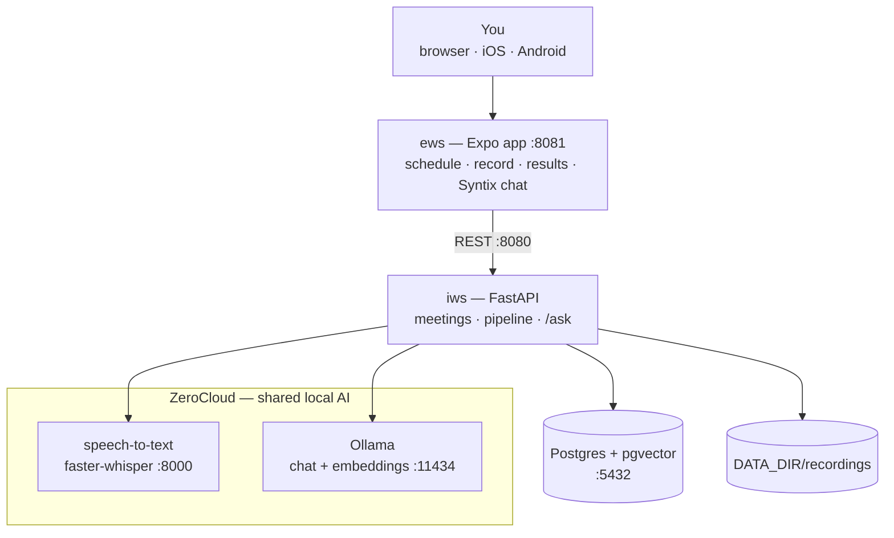

# Syntix — local meeting intelligence

Record or import a meeting, and Syntix turns it into searchable knowledge: **transcript → summary, action items and decisions → a vector index → a chat bot that answers questions about your meetings with cited sources.** Everything runs on your machine; nothing is sent to a cloud service.

Syntix is made of two projects that talk over HTTP, plus the shared local AI stack they use:

| Part | What it is | Where |
| ---- | ---------- | ----- |
| **iws** | The API: meetings, uploads, the processing pipeline, retrieval-augmented Q&A (FastAPI, Postgres + pgvector) | [iws/](iws/README.md) |
| **ews** | The client: a React Native app for the browser, iOS and Android — schedule, record, follow processing, read results, ask Syntix | [ews/](ews/README.md) |
| **ZeroCloud** | The AI models, run once for every project: speech-to-text, chat and embeddings (Ollama, faster-whisper) | [ZeroCloud/](../../ZeroCloud/README.md) |

## 🚀 Quick Start

Start the three parts in this order. Each link goes to that project's own Quick Start, which has the exact commands:

1. **[ZeroCloud](../../ZeroCloud/README.md#-quick-start)** — start the local AI models (once; shared by every project).
2. **[iws](iws/README.md#-quick-start)** — start Postgres and the API, and confirm the models are served (`make check-models`).
3. **[ews](ews/README.md#-quick-start)** — start the app; `make web` opens it at `http://localhost:8081`.

Then in the app: **Meetings → Schedule** (or **Join Meeting**), **Start** (in the lobby, check the preview and microphone and confirm consent, then **Start** again), end the call with the red button, wait for **Ready**, and ask a question in the **Syntix** tab. The full walkthrough is in [ews/README.md](ews/README.md#try-the-whole-flow).

### Usage

Each project has its own Makefile; `make help` lists its targets.

| Task | Command |
| ---- | ------- |
| Start Postgres / the API on the host | `make setup-infra` / `make start` in `iws` |
| Start Postgres and the API in containers | `make stack-up` in `iws` (needs ZeroCloud running) |
| Check that ZeroCloud has the configured models | `make check-models` in `iws` |
| Run the API tests (no Docker, no models) | `make test` in `iws` |
| Start the app in the browser / for simulators and Expo Go | `make web` / `make start` in `ews` |
| Type-check the app | `make check` in `ews` |

## ✨ Features

- **Search, reports, trends and contacts screens, light and dark themes** — all working in the app today, with sample data where the API has no endpoint yet ([which](ews/README.md#the-other-sidebar-screens))
- **Dashboard home** — sidebar navigation, charts, and a daily meeting timeline, computed from your meetings (with sample data where the API has no endpoint yet, such as contacts)
- **Full meeting flow** — schedule, start, record audio (optionally video), upload, transcribe, enrich, summarise, index, ask
- **Cited answers** — the Syntix chat answers across all meetings or one meeting, with numbered sources and timestamps, and keeps a conversation history
- **Local-first** — models run in ZeroCloud and are stored once on disk; the database and recordings stay under your own data folder
- **One client for every platform** — the same TypeScript app runs in the browser, the iOS simulator / Android emulator and on a phone
- **Consent and permissions** — a recording notice, and the system's microphone and camera prompts
- **Provider-agnostic AI** — speech-to-text, chat and embeddings are OpenAI-compatible endpoints that `.env` can point elsewhere
- **Testable without infrastructure** — the API tests use SQLite and deterministic fake AI providers

### Limits

- **Not a calling app.** The app records the device it runs on; there is no WebRTC, so it cannot place a call between devices ([details](ews/README.md#limits)).
- **Several app screens run on demo data until their API exists** (contacts, reports, trends topics, sign-in), and the whole app does while the API is down or empty; the list is in [Pending APIs](ews/README.md#pending-apis).
- **No authentication** on the API or the app, and no database migrations (tables come from `create_all`).
- **One in-process pipeline** — no job queue; a restart mid-run marks the meeting `FAILED` and it is re-processed manually ([details](iws/README.md#limits)).
- **No speaker diarisation**, and no live transcription: audio is processed after the meeting ends.
- **Needs ZeroCloud running** for transcription and answers.
- **Recording on a physical device has not been tried**; the app was type-checked, bundled for web, iOS and Android, and exercised against the API.

## 📋 Prerequisites & Dependencies

Each project documents its own requirements and dependencies, so they are not repeated here:

| Project | Requirements and tools | Dependency and environment files |
| ------- | ---------------------- | -------------------------------- |
| `iws` | [iws/README.md](iws/README.md#-prerequisites--dependencies) | [requirements.txt](iws/requirements.txt), [.env.sample](iws/.env.sample) |
| `ews` | [ews/README.md](ews/README.md#-prerequisites--dependencies) | [package.json](ews/package.json) |
| ZeroCloud | [ZeroCloud/README.md](../../ZeroCloud/README.md#-prerequisites) | `docker-compose.yml`, `.env` model lists |

## ⚙️ Build & Configuration

Configuration lives in each project: [iws/.env.sample](iws/.env.sample) (API, database, AI endpoints, indexing), [ews/app.json](ews/app.json) (permission texts, bundle ids) and the app's Settings tab (API address), and ZeroCloud's `.env` (images, ports, model lists). The settings that connect the parts:

| What | Where it is configured and documented |
| ---- | ------------------------------------- |
| The API address the app uses | [ews/README.md](ews/README.md#app-settings) (Settings tab, `EXPO_PUBLIC_API_URL`) |
| API, database, AI endpoints and models, indexing, `CORS_ORIGINS` | [iws/.env.sample](iws/.env.sample) and [iws/README.md](iws/README.md#environment-variables) |
| The API in a container, and reaching ZeroCloud from it | [iws/README.md](iws/README.md#docker-stack) |
| Which models exist, their storage and ports | [ZeroCloud/README.md](../../ZeroCloud/README.md) |

The model names in `iws/.env` must be listed in ZeroCloud's `.env`; `make check-models` in `iws` verifies it.

### Ports

| Service | Port | Owner |
| ------- | ---- | ----- |
| Syntix API | `8080` (`API_PORT`) | iws |
| Postgres + pgvector | `5432` (`DB_PORT`) | iws (Docker) |
| Expo web server | `8081` | ews |
| Ollama (chat, embeddings) / speech-to-text | `11434` / `8000` | ZeroCloud |

### Security

- **Never commit** a `.env`; each project commits only its `.env.sample`
- Containers publish their ports on `127.0.0.1` only. The API has **no authentication yet**, so do not expose it beyond localhost
- Recordings and transcripts are sensitive: point `DATA_DIR` somewhere private and durable, and set `DEBUG=false` and a narrow `CORS_ORIGINS` outside local development
- Recording consent in the app is a reminder to the user, not a legal record

## 📁 Project Layout

```
Syntix/
├── iws/                        # API — see iws/README.md
├── ews/                        # React Native app — see ews/README.md
└── README.md                   ← you are here
```

Full file-level trees are in [iws/README.md](iws/README.md#-project-layout) and [ews/README.md](ews/README.md#-project-layout). ZeroCloud sits outside this folder, at the repository root.

## 🏗️ Architecture



### Components

| ID | Component | Files |
| -- | --------- | ----- |
| C1 | App shell, navigation, screens | `ews/App.tsx`, `ews/src/utils/nav.tsx`, `ews/src/screens/` |
| C2 | Recorder, camera preview, permissions (native and web) | `ews/src/recording/` |
| C3 | Typed API client and the Syntix chat | `ews/src/api/client.ts`, `ews/src/components/ChatPanel.tsx` |
| C4 | Routes and schemas | `iws/app/routes/`, `iws/app/schemas/` |
| C5 | Pipeline, Q&A and the other services | `iws/app/services/` |
| C6 | AI providers (OpenAI-compatible, fake for tests) | `iws/app/providers/` |
| C7 | Repositories, models, engine and vector index | `iws/app/repositories/`, `iws/app/models/`, `iws/app/db/` |
| C8 | Postgres container, API container | `iws/docker-compose.yml`, `iws/infra/` |
| C9 | Speech-to-text, chat and embedding models | ZeroCloud |

How a meeting moves through the system — upload, `QUEUED → TRANSCRIBING → ENRICHING → SUMMARIZING → INDEXING → READY`, and the retrieval step of `/ask` — is described in [iws/docs/ARCHITECTURE.md](iws/docs/ARCHITECTURE.md); the client side (screens, recording layer, API client) is in [ews/docs/ARCHITECTURE.md](ews/docs/ARCHITECTURE.md).

## 🧪 Testing

```bash
cd AiSuite/Syntix/iws && make test      # API: whole pipeline over HTTP, no Docker, no models
cd AiSuite/Syntix/ews && make check     # app: type-check
```

`iws/tests/conftest.py` forces SQLite, the fake AI providers and a temporary data folder, so the API tests never touch your real data or ZeroCloud. The app can also be checked without a device by bundling it: `npx expo export --platform web` (and `--platform ios --platform android`). The end-to-end manual test, with real models and a real microphone, is in [ews/README.md](ews/README.md#manual-test-script).

## 🛠️ Troubleshooting

Each project keeps its own troubleshooting table. Start with the one that matches where the problem shows up:

| Where it shows up | See the Troubleshooting section of |
| ----------------- | ---------------------------------- |
| The app: cannot reach the API, CORS in the browser, microphone or camera blocked, Expo port in use | [ews/README.md](ews/README.md) |
| The API: `.env`, ports, Postgres, model not found, meeting `FAILED`, the Docker stack and the `zerocloud` network | [iws/README.md](iws/README.md) |
| The AI models: not installed, slow answers, ports, native Ollama | [ZeroCloud/README.md](../../ZeroCloud/README.md) |

## 📚 References

### In this repository

| Project | Link | Description |
| ------- | ---- | ----------- |
| `iws` | [iws/README.md](iws/README.md) | The API: endpoints, configuration, Docker stack, data folders |
| `iws` | [iws/docs/ARCHITECTURE.md](iws/docs/ARCHITECTURE.md), [iws/docs/CHANGELOG.md](iws/docs/CHANGELOG.md) | Architecture and release notes |
| `ews` | [ews/README.md](ews/README.md) | The React Native app: run it, permissions, limits |
| `ews` | [ews/docs/ARCHITECTURE.md](ews/docs/ARCHITECTURE.md) | Screens, recording layer, API client |
| ZeroCloud | [ZeroCloud/README.md](../../ZeroCloud/README.md) | Shared local models: setup, storage, connecting a project |

### External Documentation

| Link | Description |
| ---- | ----------- |
| [FastAPI](https://fastapi.tiangolo.com/) | The API framework |
| [pgvector](https://github.com/pgvector/pgvector) | Vector search in Postgres |
| [Expo](https://docs.expo.dev/) | Framework of the React Native app |
| [Ollama](https://github.com/ollama/ollama/blob/main/docs/openai.md) | OpenAI-compatible chat and embeddings API |
| [Speaches](https://github.com/speaches-ai/speaches) | OpenAI-compatible faster-whisper server |

## 📄 License

Add a `LICENSE` file to the repository; the projects here do not carry one yet.

## 👤 Author

- **Rohtash Lakra** — [@rslakra](https://github.com/rslakra)
