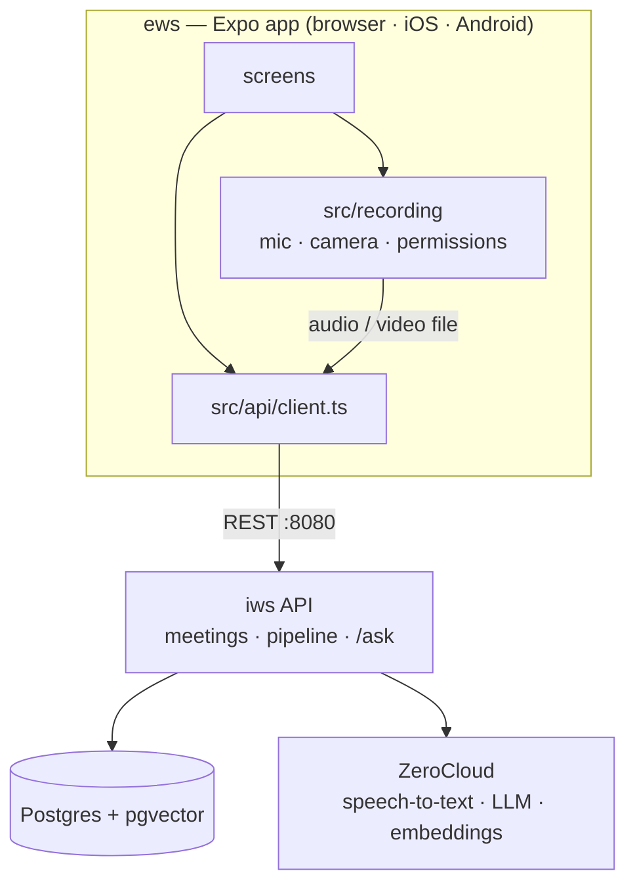

# Syntix (React Native) App

The client side of Syntix. The root of this folder is an [Expo](https://expo.dev) / React Native (TypeScript) app that exercises the whole [iws API](../iws/README.md): schedule a meeting, start it and record, upload, transcribe, read the summary, action items and decisions, and ask questions in the **Syntix** chat. The same code runs in the browser, in the iOS simulator / Android emulator, and on a phone through Expo Go.

There is no separate web server for the UI: Expo serves the browser version itself (`make web`). The app talks to the real API in [`../iws`](../iws/README.md) over HTTP and has no backend of its own. Screens whose API does not exist yet, and the whole app while the API is down or empty, run on built-in **demo data** you can click through: see [Demo data](#demo-data-works-without-the-api) and the [Pending APIs](#pending-apis) list.

## 🚀 Quick Start

```bash
# 1. the AI models (once): ZeroCloud — see ../../../ZeroCloud/README.md
# 2. the API
cd AiSuite/Syntix/iws && make setup-infra && make check-models && make setup && make install && make start
# 3. the app
cd AiSuite/Syntix/ews
make setup
make web           # browser at http://localhost:8081  (or: make start, then press i / a / w)
```

The app talks to `http://localhost:8080` by default. Change it in the **Settings** tab (it is remembered), or start with `EXPO_PUBLIC_API_URL=http://192.168.1.20:8080 make start`:

| Where the app runs | API address to use |
| ------------------ | ------------------ |
| Browser, iOS simulator | `http://localhost:8080` (the default) |
| Android emulator | `http://10.0.2.2:8080` (the app's default on Android) |
| A real phone (Expo Go) | `http://<your computer's LAN IP>:8080`; the API already listens on `0.0.0.0` |

The browser origin `http://localhost:8081` is already in the API's `CORS_ORIGINS`; add other origins there if you serve the web build elsewhere.

### Usage

```bash
make help           # list targets
make setup          # npm install
make web            # the app in the browser
make start          # Expo menu: simulators, Expo Go, browser
make check          # type-check the app
make status         # node version and whether the dependencies are installed
make clean          # remove node_modules and the Expo cache
```

### Try the whole flow

0. The app opens on the **Dashboard** ([details](#the-dashboard)). **+ New meeting** there, or **Meetings → Schedule**, starts the steps below.
1. **Meetings → Schedule**: title, date and time, participants (`Ana <ana@x.com>`, one per line). Or **Join Meeting** to create an ad-hoc meeting straight away.
2. Open the meeting and press **Start**. You land in a **lobby**, like a video call: a live preview with microphone and camera switches (the camera is off by default; audio is all that transcription needs), a level meter that moves when the microphone hears you, and, in the browser, pickers for the microphone and camera. The browser or the system asks for microphone access as the lobby opens. Switch on "Everyone has agreed to be recorded" and press **Start**.
3. You are now **in the call**: a full-screen view with your tile, a recording timer and mute, camera and end buttons. If nothing comes through the microphone for a few seconds, a notice says so, instead of letting you record silence. Press the red button to end. The app sets the end time, uploads the recording and starts processing.
4. The meeting screen shows the pipeline (transcribing → analysing → summarising → indexing) and then **Ready**. Check **Overview** (summary, action items, decisions, topics), **Transcript** (timed segments) and **Recordings** (file, size, SHA-256).
5. Ask in the **Syntix** tab (all meetings, or one meeting via the chips) or in a meeting's **Ask Syntix** tab. Answers cite numbered sources with timestamps; **History** reopens earlier threads.

No microphone handy? On any meeting use **Add audio/video file** (a file picker) or **Import transcript** (paste `Name: words` lines). Processing starts by itself, as it does when you end a call; **Process** is only for retrying a failure or running it again.

### The dashboard

The home tab: a header ("Welcome Back, *your name*", new meeting, notifications), Contacts, Performance, Results, a twelve-month Statistics chart, a Pipeline card and a **Today, Meetings** timeline with a five-day strip. On wide screens the tabs are a sidebar inside a rounded panel; on phones and narrow windows they are a scrolling bottom bar. The sidebar has **Search, Dashboard, Reports, Trends, Contacts, Syntix (chat) and Meetings**, and at the foot **Settings, Log out and a sun / moon switch** for the theme.

Every card is computed on the device from `GET /meetings`, except where the API has nothing to offer yet. Those cards use **sample data**, marked with a "Sample data" chip, so the design is complete and the API can follow:

| Card | Data today | API to build later |
| ---- | ---------- | ------------------ |
| Today, Meetings, day strip | Real: meetings by scheduled / started date | Optionally `GET /meetings?from=&to=` to avoid loading the whole list |
| Performance, Results, Pipeline | Real: counts by meeting status | `GET /stats/overview` (also would include processing time and failure reasons) |
| Statistics chart | Real: meetings and ready meetings per month | `GET /stats/monthly?months=12` |
| Notifications (bell) | Real: recently ready or failed meetings | `GET /notifications`, with read state |
| **Contacts** | **Sample**: seven made-up people | `GET /contacts` (people seen across meetings, from the participants) |
| **Everything**, when the API is unreachable or has no meetings | **Demo meetings**: a year of generated meetings and three for today, fully usable (open them, ask about them, search them; [details](#demo-data-works-without-the-api)) | none: it is a fallback, and a notice says so |

Sample data lives in `src/data/sample.ts`, the numbers in `src/utils/stats.ts`, and the loading in `src/hooks/useDashboard.ts` (refreshed every 30 seconds and on pull-to-refresh). To swap a card to a real endpoint, replace its computation there.

### The other sidebar screens

All of them work today. Where the API has nothing to offer yet they run on sample data, marked with a "Sample data" chip, so the API can be built later without changing the screens:

| Screen | What works | Real today | Sample until | API to build later |
| ------ | ---------- | ---------- | ------------ | ------------------ |
| **Search** | Search box, suggestions, highlighted excerpts with timestamps and relevance, open the meeting | `POST /search` (semantic) | the API is unreachable or there are no meetings | none: it already exists |
| **Reports** | Week / month / quarter, KPIs, meetings-by-weekday chart, generate a report, expand it, export | Meeting counts and the weekday chart | Hours, action items and decisions are estimates; the report list is kept on the screen; export is a stub | `GET /reports`, `POST /reports`, `GET /reports/{id}/export` |
| **Trends** | Meeting load over 12 months, busiest hours and day, processing success rate, trending topics | Charts and figures, from `GET /meetings` | Trending topics | `GET /stats/topics` (topics across meetings, with change) |
| **Contacts** | Search, add (name, role, email), select to see details, invite to a meeting, remove; the list is kept on this device | Nothing | Seven made-up people, then yours as you add them | `GET/POST/DELETE /contacts` (replace the body of `src/hooks/useContacts.ts`) |
| **Log out** | Confirms, forgets your name on this device, returns to the dashboard | Nothing | There are no accounts | A sign-in API (replace `signOut` in `src/utils/profile.ts`) |

### Demo data (works without the API)

The whole app is usable with no server, so the screens can be built and tried before their API exists. A small in-app backend (`src/api/mock.ts`) answers the same calls as the real API:

- **Sample meetings** (a year of them, three today) open like real ones, with participants, a recording, a transcript with speakers and timestamps, a summary, action items, decisions and topics.
- **Everything works on them:** ask the Syntix chat (suggested questions included), search, delete, and create new meetings, then upload a file or import a transcript and watch the pipeline run to **Ready** in about eight seconds. Processing starts by itself, as with the real API.
- **When it is on:** *Automatic* (the default) uses your API, and switches to demo data when it cannot be reached or has no meetings yet. A notice on the dashboard and a **Demo data** chip in the screen headers show it. A meeting you create while the API is reachable is created for real, and then replaces the demo list. **Settings → Data source** can also force *Live API only* or *Demo data*.

What it is not: it does not transcribe your voice or call a language model. A recording gets a scripted transcript, summaries and answers come from keyword matches (and say so), and everything is in memory and gone on reload. The microphone and camera, the lobby and the call screen are real; only what happens to the recording afterwards is demo.

### Look and feel

- **Typeface:** Cabin (four weights, bundled with `@expo-google-fonts/cabin`). `src/components/Text.tsx` wraps the native `Text` and picks the weight's font family, so use it instead of `react-native`'s `Text`.
- **Light and dark themes:** the sun / moon switch in the sidebar, or **Settings → Appearance** (Light, Dark, System Default). The choice is remembered on the device, and "System Default" follows the operating system live. The palettes are in `src/theme.ts`; styles that use colours are written with `createStyles(() => StyleSheet.create({...}))` so they rebuild when the theme changes (see [docs/ARCHITECTURE.md](docs/ARCHITECTURE.md#design-tokens-and-theming)).
- The in-call screen is dark in both themes, as in video-call apps.

## 🔌 APIs

### Available (the iws API, used by the app today)

| Method and path | Used for |
| --------------- | -------- |
| `GET /health` | The connection test in Settings |
| `POST /meetings`, `GET /meetings`, `GET /meetings/{id}` | Schedule, join, list, open |
| `PATCH /meetings/{id}` | Set the start and end of a call |
| `DELETE /meetings/{id}` | Delete a meeting |
| `POST /meetings/{id}/recordings`, `GET …/recordings` | Upload a recording, list recordings |
| `POST /meetings/{id}/transcript`, `GET …/transcript` | Import a transcript, read transcripts |
| `POST /meetings/{id}/process` | Transcribe, analyse, summarise and index (the app starts it by itself) |
| `GET /meetings/{id}/summary`, `GET …/enrichment` | Summary, action items, decisions, topics |
| `POST /ask` | The Syntix chat, with cited sources |
| `POST /search` | The Search screen |
| `GET /conversations`, `GET /conversations/{id}/messages` | Chat history |

### Pending APIs

These do not exist yet. Each has a screen that works today on demo data, so the API can be added later by replacing one place in the app. Suggested shapes; adjust them when you build them.

| Method and path | Needed for | Until then (demo behaviour) | Where to plug it in |
| --------------- | ---------- | --------------------------- | ------------------- |
| `GET /contacts`, `POST /contacts`, `DELETE /contacts/{id}` | Contacts screen and the dashboard's Contacts card | The list is kept on the device, starting from seven sample people | `src/hooks/useContacts.ts` |
| `POST /meetings/{id}/participants` | Invite a contact to an existing meeting | "Invite to a meeting" opens the schedule form | `ContactsScreen` |
| `GET /stats/overview` | Performance, Results and Pipeline cards | Counted on the device from `GET /meetings` | `src/utils/stats.ts` (`computeStats`) |
| `GET /stats/monthly?months=12` | Statistics chart, Trends "Meeting load" | Counted on the device | `src/utils/stats.ts` (`monthlySeries`) |
| `GET /stats/topics` | Trends "Trending topics" | A sample list | `SAMPLE_TOPICS`, `TrendsScreen` |
| `GET /stats/totals?from=&to=` (hours recorded, action items, decisions) | Reports KPIs | Estimated from the meeting count | `ReportsScreen` |
| `GET /reports`, `POST /reports`, `GET /reports/{id}/export` | Reports: list, generate, export | A list on the screen; export shows a "not available yet" message | `ReportsScreen`, `SAMPLE_REPORTS` |
| `GET /notifications`, `POST /notifications/{id}/read` | The bell on the dashboard | Derived from recently finished or failed meetings | `src/utils/stats.ts` (`notifications`) |
| `GET /meetings?from=&to=` | The "Today, Meetings" day strip without loading every meeting | The whole list is filtered on the device | `src/hooks/useDashboard.ts` |
| `GET /recordings/{id}/file` | Play or download a recording | Only its details are shown | Recordings tab, `MeetingDetailScreen` |
| `POST /auth/login`, `POST /auth/logout`, `GET /me` | Sign in, your name and avatar, Log out | The name is set in Settings and kept on the device; Log out forgets it | `src/utils/profile.ts` (`signOut`) |

The API gets no authentication until the auth endpoints exist, so do not expose it beyond your own machine.

## ✨ Features

- **Demo data that works end to end**: with no API (or none yet), sample meetings open with summaries, transcripts, action items and decisions, and chat, search, scheduling, uploads and processing all run ([details](#demo-data-works-without-the-api))
- **Light and dark themes** (switch, or follow the device) and the Cabin typeface, across every screen
- **Nine sidebar controls, all working**: Search, Dashboard, Reports, Trends, Contacts, Syntix, Meetings, Settings, Log out and the theme switch, with sample data where the API has nothing yet ([tables](#the-other-sidebar-screens))
- **A dashboard home** in the style of a modern analytics app: sidebar navigation, contacts, charts, and a daily meeting timeline, with sample data wherever the API has no endpoint yet
- **One app for every platform** — browser, iOS, Android from one TypeScript code base; platform-specific code lives in `*.web.ts(x)` files next to its native twin
- **The full iws flow** — schedule, start, record, upload, process, results, Q&A with cited sources
- **Video-call style lobby and call** — a live preview with microphone and camera switches, device pickers (browser), a microphone level meter and a full-screen call view with mute, camera and end buttons
- **Real device permissions** — microphone and camera prompts, denied-access guidance, a recording-consent step ([details](#permissions-and-consent))
- **Browser recording without extra servers** — `getUserMedia` + `MediaRecorder` on the web, `expo-audio` / `expo-camera` on devices
- **Typed API client** — `src/api/client.ts` mirrors the iws schemas in `src/types.ts`

### Permissions and consent

| What | How it is handled |
| ---- | ----------------- |
| Microphone and camera | `app.json` holds the iOS usage strings (`NSMicrophoneUsageDescription`, `NSCameraUsageDescription`) and the Android permissions; the OS shows its dialog when the lobby opens (microphone) and when you switch the camera on. In the browser, the browser shows its own prompt. The camera stays off, and unrequested, unless you switch it on. |
| Denied access | The lobby says so and offers **Open settings** (native) or browser instructions (web). In **Settings → Microphone and camera** the device's line says "Blocked by the system" (or the browser) and what to do. |
| Allow or stop using a device | **Settings → Microphone and camera** has a checkbox per device. Ticking lets Syntix use it and, if the system or browser has not been asked yet, asks it; if it was already refused, a phone opens its settings (a browser cannot be re-asked, so the line explains the lock icon). Unticking stops Syntix from using it: the lobby then says the device is turned off. An app cannot take a permission back from the system, so removing it completely is done in the system settings (or the browser's lock icon). The choice is remembered on the device. |
| Recording consent | You must switch on "Everyone has agreed to be recorded" before **Start** is enabled. This is a reminder for you, not a legal record: the app does not notify the other people. |
| Where the data goes | Only to the API address you configured. Transcription and answers use the models in ZeroCloud on your machine. |

### Limits

- **It records a meeting; it is not a calling app.** There is no WebRTC, so it cannot place a call between two devices. Use it on the device in the room, or next to a call that plays through the speaker. A real call needs a signalling server and TURN, which iws does not have.
- **Recording is one file per session**, uploaded when you end it. If the app is killed mid-recording the audio is lost. There is no live transcript.
- **Changing devices mid-call is limited.** The microphone and camera pickers are in the lobby and are browser-only (phones use the system's devices). In a call you can mute; the camera can be switched off and on only if you started with it in the browser, and not at all on phones. On phones, an audio-only call can be muted (the recording pauses), but a video call's sound cannot be changed once it is recording.
- **Video** is recorded and stored, but only the audio is used for transcription. There is no download or playback of stored recordings (iws has no endpoint for it).
- **Browser recording** needs `https` or `localhost` (a browser rule for microphone access), so testing from a phone over `http://<LAN IP>` must use Expo Go, not the phone's browser.
- **Android emulator and simulators** have no real microphone or camera by default; use their virtual-device settings, or the file upload / transcript import shortcuts.
- **Not tried on a physical device.** The type-check, the web / iOS / Android bundles and the API calls were verified; recording itself was not exercised with a real microphone or camera.
- **Some screens run on demo data until their API exists** ([Pending APIs](#pending-apis)), and the whole app does while the API is unreachable or empty ([Demo data](#demo-data-works-without-the-api)). Each is marked in the app. In demo mode a recording is not really transcribed: it gets a scripted transcript. There is no sign-in, so "Log out" only forgets your name.
- The date and time fields are plain text (`YYYY-MM-DD`, `HH:MM`) so the same screen works on every platform.
- No sign-in: the API has no authentication yet.

## 📋 Prerequisites & Dependencies

- **Node.js 22.13+** (or 24.3+) and npm (the app; Expo SDK 58 and React Native 0.88 require it); **Expo Go** on a phone, or Xcode / Android Studio for simulators (optional)
- The **iws API** running, and [ZeroCloud](../../../ZeroCloud/README.md) behind it for transcription and answers
- **`make`** (optional) — every target is a plain `npm` / `npx expo` command

| Source | Purpose |
| ------ | ------- |
| `package.json` | Expo SDK 58, React Native, `expo-audio`, `expo-camera`, `expo-document-picker`, `expo-font` + `@expo-google-fonts/cabin` (typeface), `react-native-web`, `react-native-svg` (charts), `@expo/vector-icons` (icons), AsyncStorage |

## ⚙️ Build & Configuration

### App settings

| Setting | Where | Description |
| ------- | ----- | ----------- |
| API address | **Settings** tab (stored on the device / in the browser) | Saved and used by every request |
| `EXPO_PUBLIC_API_URL` | Environment when starting Expo | Default address before anything is saved |
| Permission texts, bundle id, plugins | `app.json` | Shown in the OS permission dialogs |

### Security

- Do not put secrets in `EXPO_PUBLIC_*` variables: Expo embeds them in the app bundle
- The app has no sign-in because the API has none yet; do not expose the API beyond localhost
- Recordings leave the device for the API address you configured: use `https` for anything beyond your own machine
- List only trusted origins in the API's `CORS_ORIGINS`

## 📁 Project Layout

```
ews/
├── App.tsx                    # providers, tab bar (Meetings, Syntix, Settings), router
├── index.ts                   # Expo entry point
├── app.json                   # name, permissions, expo-audio / expo-camera plugins
├── tsconfig.json, package.json
├── assets/                    # icons and splash
├── src/                       # the app
│   ├── api/                   # client.ts (typed iws client + the router), mock.ts (demo backend), demo.ts (data source), errors.ts
│   ├── utils/                 # nav (small stack navigator), theme (light / dark), stats, format, profile, dialog helpers
│   ├── recording/             # useCallRecorder, CallPreview, DevicePickers (native + .web), permissions
│   ├── components/            # shell (sidebar / tabs), charts, panel, Text (Cabin), ui kit, call controls, ChatPanel, PipelineProgress
│   ├── screens/               # Dashboard, Search, Reports, Trends, Contacts, Meetings, Schedule, Call (lobby + call), MeetingDetail, Ask, Settings
│   ├── data/sample.ts         # sample contacts, meetings, excerpts, reports and topics (where the API has nothing yet)
│   ├── hooks/                 # useDashboard (meetings, sample fallback), useContacts (local until the API), useLogOut
│   ├── types.ts               # mirrors the iws schemas
│   └── theme.ts
├── docs/
│   └── ARCHITECTURE.md        # components, recording layer, API client, data flow, security
├── Makefile                   # setup, web, start, check, status, clean
└── README.md                  ← you are here
```

Do not name a source folder `lib/`, `build/` or `dist/`: the shared `.gitignore` rules would silently keep it out of version control.

## 🏗️ Architecture



Components, the platform split of the recorder, the API client and security notes are in [docs/ARCHITECTURE.md](docs/ARCHITECTURE.md).

### Data flow

1. **Schedule** — `POST /meetings` with `scheduled_at` and participants.
2. **Start** — `PATCH /meetings/{id}` sets `started_at`, then the recorder asks for permissions and starts.
3. **End** — the recorder stops, `PATCH` sets `ended_at`, `POST /meetings/{id}/recordings` uploads the file (multipart field `file`) and `POST …/process` starts the pipeline.
4. **Follow** — the meeting screen polls `GET /meetings/{id}` every 2 seconds until `READY` or `FAILED`, then loads the summary, enrichment, transcript and recordings.
5. **Ask** — `POST /ask` with `question`, optional `meeting_id` and `conversation_id`; sources are shown under each answer.

## 🧪 Testing

```bash
make check         # type-check the app
```

Beyond the type-check, `npx expo export --platform web` (and `--platform ios --platform android`) confirms the app bundles for every platform without a device.

### Manual test script

1. Start ZeroCloud, then the iws API (see [Quick Start](#-quick-start)); `make check-models` in `iws` should print three `ok` lines.
2. `make web`, open `http://localhost:8081`, go to **Settings → Save and test connection**: it should say "Connected".
3. Schedule a meeting, open it and press **Start**. In the lobby allow the microphone in the browser prompt and check that the level meter moves when you speak. Press **Start**, speak for a few seconds, end the call with the red button and wait for **Ready**.
4. Check the summary and transcript, then ask a question about what you said in the **Syntix** tab.

## 🛠️ Troubleshooting

| Issue | Fix |
| ----- | --- |
| "Cannot reach the Syntix API at …" | Start iws (`make start` there) or fix the address in **Settings** (see the address table above) |
| Browser: request blocked by CORS | Add the app's origin to `CORS_ORIGINS` in `iws/.env` and restart the API |
| Microphone / camera blocked | Native: **Open settings** and allow it. Browser: lock icon in the address bar → allow, then press Start again |
| Browser says it cannot record | Use `http://localhost` or `https`; a phone browser on `http://<LAN IP>` is not allowed to record |
| Meeting `FAILED` after upload | The message is shown on the meeting; usually ZeroCloud is not running or the model is missing — `make check-models` in `iws` |
| `Run: make setup` | Install the npm dependencies first |
| Port `8081` is already in use | Another Expo server is probably running; use it or stop it. If Expo moves to another port, add that origin to `CORS_ORIGINS` in `iws/.env` for the browser version |

## 📚 References

### In this repository

| README / Link | Description |
| ------------- | ----------- |
| [Syntix](../README.md) | Project overview (`iws`, `ews`, ZeroCloud) |
| [Syntix/iws](../iws/README.md) | The API this app talks to; its endpoint table is the contract |
| [ZeroCloud](../../../ZeroCloud/README.md) | Speech-to-text, chat and embedding models behind the API |

### External Documentation

| Link | Description |
| ---- | ----------- |
| [Expo](https://docs.expo.dev/) | Framework, SDK 58 modules and CLI |
| [expo-audio](https://docs.expo.dev/versions/v58.0.0/sdk/audio/) | Audio recording on devices |
| [expo-camera](https://docs.expo.dev/versions/v58.0.0/sdk/camera/) | Video recording on devices |
| [MediaRecorder](https://developer.mozilla.org/docs/Web/API/MediaRecorder) | Recording in the browser |

## 📄 License

Add a `LICENSE` file to the repository; this project does not carry one yet.

## 👤 Author

- **Rohtash Lakra** — [@rslakra](https://github.com/rslakra)
