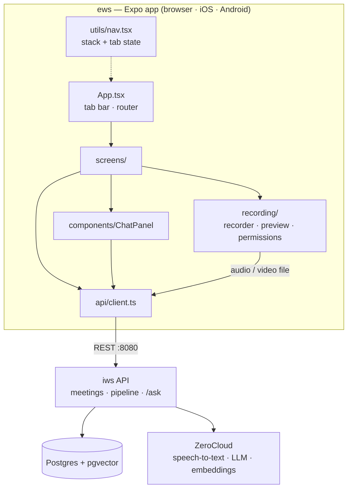

# Architecture

Detailed architecture of Syntix `ews`, the React Native client of the [iws API](../../iws/README.md). The
high-level diagram is also shown in the **Architecture** section of the [README](../README.md); keep the
two copies in sync. The API's own architecture (pipeline, data model, providers) is in
[iws/docs/ARCHITECTURE.md](../../iws/docs/ARCHITECTURE.md).

## Table of Contents

1. [Overview](#overview)
2. [Requirements](#requirements)
3. [Presentation Layer](#presentation-layer)
4. [Recording Layer](#recording-layer)
5. [API Client](#api-client)
6. [Data Flow](#data-flow)
7. [Security](#security)
8. [Scalability](#scalability)
9. [Reference](#reference)

## Overview

The app holds no business data of its own. Everything it shows comes from the iws API; the only things stored
on the device are the API address and (briefly, in memory) a recording that has not been uploaded yet. The
project has no backend of its own.

### Components

| ID | Component | Layer | File |
| -- | --------- | ----- | ---- |
| C1 | Providers and router | Presentation | `App.tsx` |
| C2 | Stack navigation and tab state | Presentation | `src/utils/nav.tsx` |
| C3 | Screens (dashboard, meetings, schedule, call, meeting detail, ask, settings) | Presentation | `src/screens/` |
| C4 | App shell (sidebar / bottom tabs), charts, UI kit, Syntix chat, pipeline progress | Presentation | `src/components/` |
| C5 | Recorder, camera preview, permission status (native + web) | Recording | `src/recording/` |
| C6 | Typed API client and API address | Integration | `src/api/client.ts` |
| C7 | API types, formatting and dialog helpers, theme | Shared | `src/types.ts`, `src/utils/`, `src/theme.ts` |
| C8 | Permission texts, bundle ids, plugins | Configuration | `app.json` |
| C9 | Dashboard data: statistics from the meeting list, loading, sample data | Data | `src/utils/stats.ts`, `src/hooks/useDashboard.ts`, `src/data/sample.ts` |

## Requirements

**Functional**

- Schedule a meeting, or start an ad-hoc call, and list meetings with their processing status
- Start a meeting: ask for consent and device permissions, record audio (optionally video), end it and upload the file
- Alternatives to recording: upload an existing audio/video file, or import a transcript
- Show the processing progress and the results: summary, action items, decisions, topics, transcript, recordings
- Ask questions in the Syntix chat across all meetings or one meeting, with cited sources and a conversation history

**Non-functional**

- **One code base, three platforms** — browser, iOS and Android; platform differences are isolated in `*.web.ts(x)` files
- **Explicit consent and permissions** — recording starts only after the consent switch and the OS or browser permission
- **Local-first** — the app talks only to the API address the user configured
- **No state to lose** — the server is the source of truth; screens reload from the API

**Known constraints** are listed in the README's [Limits](../README.md#limits).

## Presentation Layer

**Navigation.** `utils/nav.tsx` is a minimal stack navigator: a list of routes (`home`, `schedule`,
`meeting`, `call`) where the last one is on screen. `push`, `replace` and `pop` change it, and Android's
back button pops (`BackHandler`). The selected tab (Search, Dashboard, Reports, Trends, Contacts, Syntix, Meetings,
Settings) lives in the same provider, so it survives opening and closing a meeting. There is no deep linking or URL routing; the browser URL
does not change.

**App shell** (`components/shell.tsx`). The root route renders `AppShell`. On windows at least 900 px wide it is a
white sidebar of icons inside a rounded panel on a backdrop: the logo, then **Search, Dashboard, Reports, Trends,
Contacts, Syntix and Meetings**, and at the foot **Settings, Log out and a sun / moon switch**. Below 900 px the
same tabs are a horizontally scrolling bottom bar (the theme switch and log out are in Settings there). Screens
pushed on top of the tabs (schedule, meeting detail) get the same panel without the sidebar (`Framed`); the call is
full-screen.

### Design tokens and theming

- **Tokens** (`src/theme.ts`): a light and a dark palette with the same roles (surface, card, text, muted, border, primary, navy, pink, teal, green, danger, warn), the radii, the soft card `shadow` (a `boxShadow`, which the web and the new architecture both support), pastel tints and the font family names. `ui.tsx` builds on them (pill buttons, borderless soft-shadow cards, round back button), so a screen that uses the kit follows the design without its own styling.
- **A live palette.** `colors` and `shadow` are objects that `applyTheme(mode)` rewrites in place. Because React Native styles are normally built once at load, every stylesheet that uses them is written as `createStyles(() => StyleSheet.create({...}))`, which rebuilds when the theme changes. Colours kept in a constant at module level would go stale, so they are functions instead (`statusStyles()`, `cardColors()`).
- **The provider** (`utils/theme.tsx`). The saved choice (Light, Dark or Same as device, in AsyncStorage) is read before the first screen renders, so nothing flashes. `ThemeProvider` follows the operating system when the choice is "system", applies the palette during render, and remounts everything below it when the mode changes (keyed by mode), so every screen rebuilds. It sits inside the navigation provider, so the current tab and stack survive a switch. `reload()` forces the same rebuild after a log out.
- **Typeface.** Cabin, loaded with `expo-font` in `App.tsx`; the app waits for it (or for a failure, in which case the system font is used). On phones each weight is a separate font family, so `components/Text.tsx` wraps the native `Text` and chooses the family from `fontWeight`. Text inputs name their family in their styles.
- **The call screen** is deliberately dark in both themes.

**Screens** (`src/screens/`):

| Screen | Responsibility |
| ------ | -------------- |
| `DashboardScreen` | The home tab: welcome header, new meeting, notifications, Contacts, Performance, Results, a twelve-month Statistics chart, Pipeline and a Today timeline with a five-day strip. Numbers are computed from `GET /meetings`; contacts, and everything while the API is unreachable or empty, are sample data and are marked as such (see the README) |
| `SearchScreen` | A search box, suggestions and results with the searched words marked, timestamps and a relevance score; `POST /search`, with sample results when the API is unreachable or has no meetings |
| `ReportsScreen` | Week / month / quarter KPIs and a meetings-by-weekday chart from the meeting list; hours, action items and decisions are estimates; generated reports are kept on the screen (sample) until a reports API exists |
| `TrendsScreen` | Twelve-month meeting load, busiest hours and day, success rate (all from the meeting list) and trending topics (sample) |
| `ContactsScreen` | Search, add, select and remove contacts, kept on the device through `useContacts` (sample list at first) until a contacts API exists; invite to a meeting |
| `MeetingsScreen` | Lists meetings, newest first, with a status badge; "Join Meeting" creates an ad-hoc meeting; refreshes every 3 s while any meeting is being processed |
| `ScheduleScreen` | Form for title, date and time, participants and language; validates the date and time; can save and start straight away |
| `CallScreen` | Two views like a video call. The **lobby**: live preview tile, microphone and camera switches, microphone level meter, device pickers (browser), the recording consent and **Start**. The **call**: a full-screen dark view with your tile, a recording timer, mute / camera / end buttons and a notice when the microphone is silent. Then saving, and a retry when the upload fails |
| `MeetingDetailScreen` | Overview (status, actions, summary, action items, decisions, topics), Transcript, Recordings, and a chat limited to this meeting; polls every 2 s while processing |
| `AskScreen` | The Syntix chat: scope chips (all meetings or one), new chat, conversation history |
| `SettingsScreen` | Your name (shown on your tile), appearance (light, dark, same as device), API address with a connection test, microphone and camera status, privacy note, log out |

**Components** (`src/components/`): `ui.tsx` holds the small kit (screen frame, button, card, field, chip,
status badge, a plain-text renderer for the Markdown summary); `CallControls.tsx` has the round call buttons
(icons from `@expo/vector-icons`), the microphone level meter and the avatar; `ChatPanel` sends questions and shows answers
with expandable sources; `PipelineProgress` maps the meeting status to the pipeline steps.

**Charts** (`components/charts.tsx`, on `react-native-svg`): `LineChart` draws smooth two-line curves with a dashed
grid and a tap-to-move marker and tooltip, `Donut` a segmented ring, `ProgressBar` a thin bar. They take plain
numbers, so a card can switch from computed to API data without touching them.

**Dashboard data.** `utils/stats.ts` turns the meeting list into the numbers (counts by status, meetings per month,
meetings on a day, recent results); `hooks/useDashboard.ts` loads the list every 30 seconds and substitutes the
generated sample from `data/sample.ts` when it is empty or the API cannot be reached. Sample meetings have ids
starting with `sample-`, are never sent to the API and are not clickable. Reports and Trends read the same hook.

**Where the sample data ends.** Each sample feature has one seam to replace when its API exists: `useContacts`
(contacts), the `SAMPLE_REPORTS` and `SAMPLE_TOPICS` lists and the estimate arithmetic in `ReportsScreen`
(reports, topics), `signOut` in `utils/profile.ts` (sign-in), and `sampleSearch` in `SearchScreen` (a fallback only:
search itself already uses the API). The README lists the endpoints.

State is local to each screen (`useState`); there is no global store. Data is fetched on mount and re-fetched
after every action.

## Recording Layer

`src/recording/` hides the platform behind one interface, `CallRecorder` (`types.ts`). Its life has two parts:

- **Lobby** — `prepare()` asks for microphone access and opens the devices, so the preview and the level meter
  work before anything is recorded. `setMicEnabled`, `setCameraEnabled`, `selectMicrophone` and `selectCamera`
  change the setup (the camera is off by default).
- **Call** — `start()` records what the lobby showed, `stop()` returns the file, `cancel()` throws it away and
  releases the devices. `state`, `elapsedMs`, `level` (0 to 1, or `null` when it cannot be measured), `error`,
  `permission` and the flags `canToggleMic` / `canToggleCamera` drive the screen.

| Concern | Native (iOS, Android) | Browser |
| ------- | --------------------- | ------- |
| Recorder | `useCallRecorder.ts` — `expo-audio` for audio only, `expo-camera` (`CameraView.recordAsync`) for audio + video | `useCallRecorder.web.ts` — `getUserMedia` + `MediaRecorder` for both |
| Output | `.m4a` (audio) or `.mp4` / `.mov` (video) file URI | `.webm` (or `.mp4` on Safari) `Blob` plus a blob URL |
| Preview | `CallPreview.tsx` — the `CameraView` that also records; it must be mounted and ready before recording starts, and the call view mounts a new one, so `start()` waits for its "ready" | `CallPreview.web.tsx` — a `<video>` showing the live stream, muted to avoid echo |
| Level meter | `expo-audio` metering while recording audio only (none for video) | Web Audio `AnalyserNode` on the stream, in the lobby and in the call |
| Mute | Audio only: the recorder is paused (the muted time is not recorded). Video: the camera view's `mute`, fixed when recording starts | The audio track is disabled; the recording carries silence |
| Camera in the call | Cannot be switched | The video track is disabled and enabled (black frames while off); only possible if the call began with video |
| Devices | The system's microphone and camera | Pickers from `enumerateDevices` (`DevicePickers.web.tsx`), changeable in the lobby |
| Permissions | OS dialog on first use (`app.json` holds the iOS usage strings and Android permissions); `permissions.ts` reads and requests the status | Browser prompt on `getUserMedia`; `permissions.web.ts` uses the Permissions API where available |

Metro and TypeScript pick the `.web` file in the browser and the plain file elsewhere, so screens import
`useCallRecorder`, `CallPreview` and `permissions` without knowing which one they get.

**Recording flow** (`CallScreen`): the lobby opens and calls `prepare()` → the consent switch enables **Start** →
`PATCH started_at` (an unreachable API is reported before any recording begins) → the screen switches to the call
view and `recorder.start()` records → a once-a-second check shows a notice if the microphone stays below a small
level for five seconds → the red button stops the recorder and returns a `RecordedMedia` (`uri`, `name`,
`mimeType`, `durationMs`, `hasVideo`, and `blob` on the web). The name on the tile is set in Settings
(`src/utils/profile.ts`).

**Failure handling.** A denied permission leaves the recorder idle with a message and `permission = denied`,
which makes the screen show how to unblock it. If the upload fails the `RecordedMedia` stays in memory so
**Retry upload** can resend it; it is lost only if the app is closed. Leaving the screen while recording (the
on-screen Back button or Android's back button) asks for confirmation, Back is ignored while the file is being
saved, and the browser recorder releases the camera and microphone on unmount.

## API Client

`src/api/client.ts` is the only code that talks to the network.

- **API address** — resolved in this order: the value saved in Settings (AsyncStorage, key `syntix.apiUrl`), then `EXPO_PUBLIC_API_URL`, then `http://10.0.2.2:8080` on Android or `http://localhost:8080` elsewhere. It is loaded before the first screen renders.
- **Errors** — a failed request throws `ApiError(status, message)`. The message is the API's `detail` (validation errors are joined); `status = 0` means the server could not be reached, with a hint on how to start it or fix the address.
- **Upload** — multipart field `file`. On the web the `Blob` is appended with its file name; on native an `{ uri, name, type }` object is appended and React Native reads the file when sending. No `Content-Type` header is set so `fetch` adds the multipart boundary.
- **Missing results** — `getSummary` returns `null` on `404` (not processed yet) instead of failing.
- **Time** — the client sends UTC ISO strings. The API stores timestamps without a time zone, so `parseServerDate` reads values without a zone suffix as UTC and the screens show them in local time.
- **Types** — `src/types.ts` mirrors the iws pydantic schemas. When an endpoint changes, update that file and the client together.

## Data Flow

1. **Schedule** — `POST /meetings` with `scheduled_at` (UTC) and participants parsed from the form (`Name`, `Name <email>`, or an address).
2. **Start** — `PATCH /meetings/{id}` sets `started_at` and clears `ended_at`, then the recorder starts.
3. **End** — the recorder stops; `PATCH` sets `ended_at`; `POST /meetings/{id}/recordings` uploads the file; `POST …/process` starts the server-side pipeline (transcribe → enrich → summarise → index); the app opens the meeting.
4. **Follow** — the meeting screen polls `GET /meetings/{id}` every 2 seconds. When the status leaves the in-progress states it loads `…/recordings`, `…/transcript`, `…/summary` and `…/enrichment`.
5. **Ask** — `POST /ask` with `question`, optional `meeting_id` and the `conversation_id` of the thread; the answer and its numbered sources are shown, and `GET /conversations` and `…/messages` restore earlier threads.

Without a microphone, step 3 can instead use **Add audio/video file** (document picker, then the same upload) or
**Import transcript** (`POST /meetings/{id}/transcript`). Both start `process` automatically, like ending a call does
(skipped if a run is already in progress). The **Process** button on the meeting only retries a failure or runs the
pipeline again (`POST …/process`, optionally with `retranscribe=true`).

### Meeting status

`CREATED → RECORDED → QUEUED → TRANSCRIBING → ENRICHING → SUMMARIZING → INDEXING → READY`, or `FAILED` with
`error_message`. The app shows the in-progress states as a step list and disables actions that would conflict
(the API answers `409` if a meeting is processed twice at once).

### Changing the contract

To use a new API endpoint: add its types to `src/types.ts`, add a method to `api` in `src/api/client.ts`, and
call it from a screen. To add a screen: add a route to `Route` in `src/utils/nav.tsx`, render it in `Router`
(`App.tsx`) and navigate with `push` / `replace`. Do not name a source folder `lib/`, `build/` or `dist/`: the
shared `.gitignore` rules would keep it out of version control.

## Security

- The app has no sign-in because the API has none yet; do not expose the API beyond localhost
- Recordings and the questions asked leave the device for the configured API address only; use `https` for anything beyond your own machine
- Microphone and camera access are requested at the moment of use, with explanations in `app.json` (iOS) and in the app; the camera only when video is chosen
- The consent switch is a reminder to the user, not a legal record, and the other participants are not notified
- The browser requires `https` or `localhost` for microphone access, which also limits where the web version can run
- The API's `CORS_ORIGINS` must list the browser origin of the app (`http://localhost:8081` for the dev server)

## Scalability

The app is a thin client, so scaling is the API's concern ([iws](../../iws/docs/ARCHITECTURE.md#scalability)).

- A recording is one file held in memory (web) or on disk (native) until it is uploaded; very long meetings mean large uploads, limited by the API's `MAX_UPLOAD_MB`
- Status is found by polling, which is simple but costs a request every 2 to 3 seconds per open screen; a server push channel would replace it
- Native video recording is built on `expo-camera`; the audio-only, browser and bundling paths were verified, but recording on a physical device has not been exercised

## Reference

- [Expo](https://docs.expo.dev/)
- [expo-audio](https://docs.expo.dev/versions/v58.0.0/sdk/audio/) and [expo-camera](https://docs.expo.dev/versions/v58.0.0/sdk/camera/)
- [MediaRecorder](https://developer.mozilla.org/docs/Web/API/MediaRecorder)
- [iws README](../../iws/README.md) — the endpoint table is the contract this client follows
