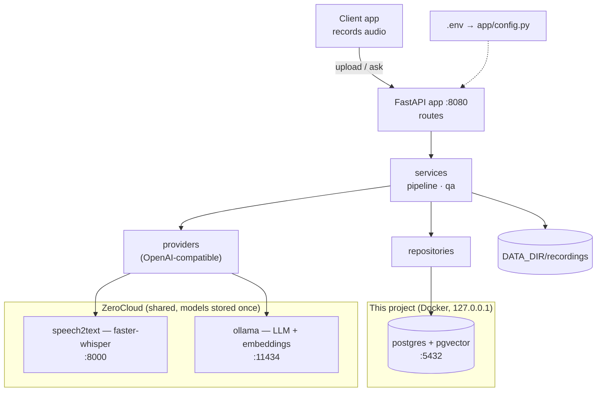

# Syntix - IWS Service

A FastAPI backend that turns meeting recordings into searchable knowledge: **upload a recording → transcribe → enrich (action items, decisions, topics) → summarise → build a vector index → ask questions about your meetings.**

Everything runs on your machine. This project owns only **Postgres with pgvector** (relational data *and* vectors, a Docker container) and the API. The LLM, embedding model and speech-to-text (Ollama, faster-whisper) come from the shared **[ZeroCloud](../../../ZeroCloud/README.md)** stack, which keeps each model once on disk for every project, so iws needs no model storage of its own. No data leaves the host. Every endpoint, model and tuning knob is configurable through `.env`.

## 🚀 Quick Start

```bash
# 1. the AI models (once, shared by all projects) — see ZeroCloud/README.md
cd ZeroCloud
make setup              # creates .env; review DATA_DIR and the model lists
make start && make setup-models

# 2. this project
cd AiSuite/Syntix/iws
make init-env           # creates .env from .env.sample — set DB_PASSWORD and DATA_DIR
make setup-infra        # Postgres+pgvector (Docker)
make check-models           # confirms ZeroCloud answers and has the models from .env
make setup && make install && make start
```

`LLM_MODEL`, `EMBEDDING_MODEL` and `STT_MODEL` in iws's `.env` must be listed in ZeroCloud's `.env` (`LLM_MODELS`, `EMBEDDING_MODELS`, `STT_MODELS`), whose defaults already match.

Open:

- `http://localhost:8080/docs` — interactive OpenAPI docs
- `http://localhost:8080/health` — health check

Prefer everything in containers (API included)?

```bash
make -C ../../../ZeroCloud start     # creates the "zerocloud" network the API joins
make init-env && make stack-up
```

### Try it

```bash
# 1. create a meeting
curl -s -X POST localhost:8080/meetings -H 'content-type: application/json' \
  -d '{"title":"Q3 planning","participants":[{"name":"Ana"},{"name":"Bob"}]}'
ID=<id from the response>

# 2a. upload what your client recorded …
curl -s -F file=@planning.m4a localhost:8080/meetings/$ID/recordings
# 2b. … or import an existing transcript ("Name: words" lines set the speaker)
curl -s -X POST localhost:8080/meetings/$ID/transcript -H 'content-type: application/json' \
  -d '{"text":"Ana: We decided to cut the cloud budget by 10%.\nBob: I will send the numbers by Friday."}'

# 3. run the pipeline (background) and poll the status
curl -s -X POST localhost:8080/meetings/$ID/process
curl -s localhost:8080/meetings/$ID                 # status → READY (or FAILED + error_message)

# 4. read the results
curl -s localhost:8080/meetings/$ID/summary
curl -s localhost:8080/meetings/$ID/enrichment

# 5. ask questions — across all meetings, or scoped with "meeting_id"
curl -s -X POST localhost:8080/ask -H 'content-type: application/json' \
  -d '{"question":"What did we decide about the cloud budget?"}'
```

### Usage

```bash
make help                # list targets
make status              # venv, .env and Python version
make show-config         # PROJECT_TITLE, APP_MODULE, ports, PYTHONPATH
make test                # pytest (no Docker needed)
make check-models            # ZeroCloud endpoints and models reachable?
make check-infra-status  # container status
make check-infra-logs    # follow container logs
make stack-down          # stop containers (data is kept in DATA_DIR)
make clean               # remove .venv and .pytest_cache
```

### API

| Method & path | What it does |
| ------------- | ------------ |
| `POST /meetings` | Create a meeting (title, language, times, participants) |
| `GET /meetings`, `GET /meetings/{id}` | List / read; the status shows pipeline progress |
| `PATCH /meetings/{id}` | Partial update of title, description, language and `scheduled_at` / `started_at` / `ended_at` (clients set the start and end of a live meeting) |
| `DELETE /meetings/{id}` | Soft delete (sets `delete_at`; hidden from lists and search) |
| `POST /meetings/{id}/recordings` | Upload audio/video (multipart field `file`) |
| `GET /meetings/{id}/recordings` | List uploaded recordings |
| `POST /meetings/{id}/transcript` | Import a transcript (`text` or timed `segments`) instead of STT |
| `GET /meetings/{id}/transcript` | Transcripts with their timed segments |
| `POST /meetings/{id}/process` | Run transcribe → enrich → summarise → index in the background (`202`); `?retranscribe=true` redoes speech-to-text |
| `GET /meetings/{id}/enrichment` | Action items, decisions, topics |
| `GET /meetings/{id}/summary` | Latest summary (Markdown) |
| `POST /ask` | Retrieval-augmented answer with numbered, cited sources; pass `conversation_id` to continue a thread |
| `POST /search` | Semantic search only — matching excerpts, no LLM call |
| `GET /conversations`, `GET /conversations/{id}/messages` | Q&A history |

Meeting status moves `CREATED → RECORDED → QUEUED → TRANSCRIBING → ENRICHING → SUMMARIZING → INDEXING → READY`, or `FAILED` with `error_message`.

## ✨ Features

- **Local-first stack** — Postgres+pgvector in Docker, all data under `DATA_DIR`; the AI models are served by the shared ZeroCloud stack and stored once on disk; works offline once the models are downloaded ([details](#offline-use))
- **Full pipeline** — transcribe → enrich → summarise → index → cited question answering
- **Provider-agnostic AI** — OpenAI-compatible speech-to-text, chat and embeddings, configured in `.env`
- **Resumable & idempotent** — re-running `process` is safe; long meetings are handled window by window
- **Test without Docker** — SQLite and deterministic fake providers

Every feature, change and bug fix is recorded in [docs/CHANGELOG.md](docs/CHANGELOG.md).

### Limits

- **Recording happens in the client.** A container cannot reach a microphone, so a browser/desktop client captures audio and uploads it (`POST …/recordings`). There is no live streaming transcription.
- **No speaker diarisation.** STT segments carry timestamps but no speaker; imported transcripts can name speakers.
- **One in-process pipeline.** `process` uses FastAPI background tasks. If the API restarts mid-run the meeting is marked `FAILED` on startup and can be re-processed; there is no job queue or multi-worker coordination.
- **No auth and no migrations.** Tables come from `create_all`. Changing `EMBEDDING_DIMENSIONS` (or the embedding model) needs `index_chunks` dropped and meetings re-processed.
- Action-item `status` exists in the model but has no update endpoint yet.
- **Needs ZeroCloud running.** Without it the pipeline fails at the first AI call; `make check-models` tells you what is missing. `make test` does not need it.
- The `pgvector/pgvector` image is configurable but was not started in this repo's CI.

## 📋 Prerequisites & Dependencies

- **Python 3.11+** (uses `StrEnum` and `typing.Self`)
- **Docker** with Compose v2 (`docker compose`) — Postgres
- **[ZeroCloud](../../../ZeroCloud/README.md)** running — Ollama (chat + embeddings) and speech-to-text
- **`make`** and **`curl`** (`make check-models`)
- **`lsof`** (optional) — `make start` uses it for the port check
- Disk and RAM for the models are ZeroCloud's concern: `llama3.1:8b` needs roughly 5 GB of disk and 8 GB of RAM; choose a smaller `LLM_MODEL` on small machines

| Source | Purpose |
| ------ | ------- |
| `requirements.txt` | `fastapi`, `uvicorn`, `pydantic-settings`, `sqlalchemy`, `psycopg[binary]`, `pgvector`, `python-multipart`, `httpx2`, `pytest` |
| `.env.sample` | Environment template copied by `make init-env` (read by the API **and** docker-compose) |
| `docker-compose.yml` | Local containers: `postgres`, and `iws` (the API, profile `app`) |

## ⚙️ Build & Configuration

### Build

```bash
make init-env     # copy .env.sample to .env
make setup        # create .venv
make install      # pip install -r requirements.txt
make setup-infra  # start the Postgres container
make check-models     # verify ZeroCloud serves the models named in .env
```

Models are downloaded and managed in ZeroCloud, not here: add a name to the matching list in `ZeroCloud/.env` and run `make setup-models` there (installed models are skipped; `FORCE=1` pulls again). `make check-models` here confirms that the chat, embedding and speech-to-text models from this project's `.env` are available.

#### Offline use

Internet access is needed only to download: the Docker images (once) and the models, which ZeroCloud fetches on its first `make setup-models` or when `LLM_MODEL`, `EMBEDDING_MODEL` or `STT_MODEL` changes. The models are served from ZeroCloud's `DATA_DIR`, so processing meetings and asking questions work offline.

If transcription hangs or fails while offline, see the offline note in the Troubleshooting table of [ZeroCloud's README](../../../ZeroCloud/README.md).

`make start` and `make test` depend on `install`, so the virtualenv is re-checked each run.

### Docker stack

| Service | Image (override with) | Port (override with) | Persistent data |
| ------- | --------------------- | -------------------- | --------------- |
| `postgres` | `pgvector/pgvector:pg$POSTGRES_VERSION` (`POSTGRES_VERSION` = 18; or override with `POSTGRES_IMAGE`) | `DB_PORT` = 5432 | `DATA_DIR/postgres/pg18` |
| `iws` (profile `app`) | built from `infra/Dockerfile` | `API_PORT` = 8080 | `DATA_DIR/recordings` |

Ollama and speech-to-text are **not** part of this compose file; they run in [ZeroCloud](../../../ZeroCloud/README.md) (images, ports, GPU and native-Ollama options are configured there).

- `make setup-infra` starts `postgres` only (run the API locally with reload); `make stack-up` adds `iws`. `make stack-down` stops both.
- Container names: `syntix-postgres` and the API, which is named after `APP_NAME` from `.env` (`syntix-iws` in `.env.sample`). Keep `APP_NAME` a valid container name: letters, digits, `_`, `.` and `-`.
- The `iws` container joins ZeroCloud's external `zerocloud` network (created by `make start` there; `make stack-up` checks it exists) and reaches the models at `http://zerocloud-ollama:11434/v1` and `http://zerocloud-speech2text:8000/v1`. Override them with `CONTAINER_LLM_BASE_URL` / `CONTAINER_STT_BASE_URL` in `.env`. When ZeroCloud uses a **native Ollama** (a Mac, for GPU speed) the `zerocloud-ollama` name does not exist: set `CONTAINER_LLM_BASE_URL=http://host.docker.internal:11434/v1`.
- In the `iws` container, `DB_HOST`, `STT_BASE_URL`, `LLM_BASE_URL`, `STORAGE_PATH` and `DEBUG` are overridden by `docker-compose.yml`; everything else comes from the mounted `.env`.
- `EMBEDDING_BASE_URL` empty → embeddings use `LLM_BASE_URL`. If you set a custom embedding URL pointing at `localhost`, it will not resolve inside the `iws` container.

### Environment variables

`app/config.py` reads `iws/.env`; a missing file raises `FileNotFoundError` with the `make init-env` hint. Real environment variables win over `.env`.

**Application**

| Variable | Description | Default |
| -------- | ----------- | ------- |
| `APP_NAME` / `APP_ENV` | FastAPI title and API container name / name returned by `/health` | `syntix-iws` / `local` |
| `API_HOST` / `API_PORT` | API bind address | `0.0.0.0` / `8080` |
| `DEBUG` | FastAPI debug and uvicorn reload | `true` |
| `CORS_ORIGINS` | Comma-separated allowed origins | `http://localhost:3000,…` |
| `LOG_LEVEL` / `LOG_FILE` | Logging level and file | `INFO` / `app.log` |

**Database** (`DB_BACKEND=postgres` is the real backend; `sqlite` is for tests and quick experiments — vectors are then searched in Python)

| Variable | Description | Default |
| -------- | ----------- | ------- |
| `DB_BACKEND` | `postgres` or `sqlite` | `postgres` |
| `DB_HOST` / `DB_PORT` / `DB_NAME` / `DB_USER` / `DB_PASSWORD` | Postgres connection (also used to initialise the container) | `localhost` / `5432` / `syntix` / `syntix` / `change-me` |
| `DB_PATH` | SQLite file (`DB_BACKEND=sqlite` only); empty → `DATA_DIR/sqlite/app.db`, relative → under `DATA_DIR` | *(empty)* |

**Data folders** — one base folder, everything else lives beneath it

| Variable | Description | Default |
| -------- | ----------- | ------- |
| `DATA_DIR` | Base folder for this project's persistent data (`~` is expanded); AI models are stored by ZeroCloud, not here | `~/Downloads/Data/Syntix` |
| `STORAGE_PATH` | Uploads folder; empty → `DATA_DIR/recordings`, relative → under `DATA_DIR` | *(empty)* |
| `MAX_UPLOAD_MB` | Upload size limit | `1024` |

```
$DATA_DIR/
├── postgres/pg18/ # Postgres data, one folder per POSTGRES_VERSION (container)
├── recordings/   # Uploaded audio/video — the API's STORAGE_PATH
└── sqlite/       # app.db, only with DB_BACKEND=sqlite
```

`make setup-infra` / `make stack-up` create these folders and print the resolved path. Models are in ZeroCloud's `DATA_DIR` (`ollama/`, `hf-cache/`); see [Migrating models from the old layout](#migrating-models-from-the-old-layout). Start the containers through `make` rather than calling `docker compose` directly: Compose does not expand `~` inside `.env` values, while the Makefile exports `DATA_DIR` as an absolute path first.

**AI providers** — each is an OpenAI-compatible endpoint

| Variable | Description | Default |
| -------- | ----------- | ------- |
| `AI_PROVIDER` | `openai_compatible`, or `fake` (deterministic offline stubs) | `openai_compatible` |
| `STT_BASE_URL` / `STT_MODEL` / `STT_API_KEY` | Speech-to-text (`/audio/transcriptions`) | `http://localhost:8000/v1` / `Systran/faster-whisper-small` / `not-needed` |
| `STT_LANGUAGE` / `STT_TIMEOUT_SEC` | Force a language (empty = auto-detect) / request timeout | *(empty)* / `1800` |
| `LLM_BASE_URL` / `LLM_MODEL` / `LLM_API_KEY` | Chat model for enrichment, summaries and answers | `http://localhost:11434/v1` / `llama3.1:8b` / `ollama` |
| `LLM_TEMPERATURE` / `LLM_TIMEOUT_SEC` | Sampling temperature / request timeout | `0.2` / `300` |
| `LLM_CONTEXT_CHARS` | Transcript window size for long meetings | `24000` |
| `EMBEDDING_BASE_URL` / `EMBEDDING_API_KEY` | Empty → reuse the `LLM_*` values | *(empty)* |
| `EMBEDDING_MODEL` | Embedding model | `nomic-embed-text` |
| `EMBEDDING_DIMENSIONS` | Vector size — **must match the model**; fixed when `index_chunks` is created | `768` |
| `EMBEDDING_BATCH_SIZE` | Texts per embedding request | `32` |

**Indexing and Q&A**

| Variable | Description | Default |
| -------- | ----------- | ------- |
| `CHUNK_TARGET_CHARS` / `CHUNK_OVERLAP_CHARS` | Chunk size and overlap | `1200` / `200` |
| `RETRIEVAL_TOP_K` | Excerpts passed to the LLM | `6` |
| `RETRIEVAL_MIN_SCORE` | Minimum cosine similarity (0–1) to keep an excerpt | `0.0` |
| `QA_HISTORY_MESSAGES` | Earlier turns included in a follow-up question | `6` |

**Docker only:** `POSTGRES_VERSION`, `POSTGRES_IMAGE` (optional full override), `CONTAINER_LLM_BASE_URL`, `CONTAINER_STT_BASE_URL` (what the `iws` container uses instead of `LLM_BASE_URL` / `STT_BASE_URL`; defaults point at the ZeroCloud containers).

The Ollama and speech-to-text images and ports (`OLLAMA_IMAGE`, `STT_IMAGE`, `OLLAMA_PORT`, `STT_PORT`) now belong to ZeroCloud's `.env`. If you changed a port there, change `LLM_BASE_URL` / `STT_BASE_URL` here to match.

#### Postgres version

`pgvector/pgvector` publishes images for Postgres **15, 16, 17 and 18**; the default is 18. Set `POSTGRES_VERSION` in `.env` to change it. Each version uses its own folder (`DATA_DIR/postgres/pg<version>`), because a data directory cannot be opened by a different major version — switching starts an empty database. To carry data across versions, dump and restore (`pg_dump` from the old container, `psql` into the new one) or use `pg_upgrade`; both are outside this project's tooling.

#### Swapping models and providers

```bash
# a different local chat model
LLM_MODEL=qwen2.5:7b            # also add it to LLM_MODELS in ZeroCloud/.env, then: make setup-models there

# a different embedding model (change the dimensions to match, then re-index)
EMBEDDING_MODEL=mxbai-embed-large   # also add it to EMBEDDING_MODELS in ZeroCloud/.env
EMBEDDING_DIMENSIONS=1024

# a hosted OpenAI-compatible service instead of Ollama
LLM_BASE_URL=https://api.openai.com/v1
LLM_API_KEY=sk-...
LLM_MODEL=gpt-4o-mini
```

If you change the embedding model or dimensions on an existing database, drop the index table and re-process meetings:

```bash
docker exec -it syntix-postgres psql -U syntix -d syntix -c 'DROP TABLE index_chunks;'
```

### Make variables

| Variable | What it does |
| -------- | ------------ |
| `PROJECT_TITLE` | Banner in `make help` (default `Syntix API`) |
| `APP_MODULE` | Entry module for `make start` (default `app.main`) |
| `ROOT_DIR` | The folder containing the Makefile (computed, read-only in practice) — every other path is built from it |
| `VENV_DIR` | Virtualenv path (default `$(ROOT_DIR)/.venv`) |
| `API_HOST` / `API_PORT` | Host and port used for the startup message and port check |
| `PYTHONPATH` | Import root for `start` and `test` (default `$(ROOT_DIR)`) |
| `COMPOSE` | Compose command for the Docker targets (default: `docker compose` with `--project-directory`, `--env-file` and `-f` pointing into `$(ROOT_DIR)`) |
| `FILE` | Run one test file, relative to the project root: `make test FILE=tests/test_pipeline.py` |

All targets resolve paths from `ROOT_DIR`, so they behave the same from any directory: `make -C AiSuite/Syntix/iws start` or `make -f AiSuite/Syntix/iws/Makefile test`.

### Security

- **Never commit** `.env` — only `.env.sample` with placeholders. Change `DB_PASSWORD` before first `make setup-infra`: Postgres stores it in `DATA_DIR/postgres/pg<version>` on first start.
- Container ports are published on `127.0.0.1` only. The API itself has **no authentication yet** — don't expose it beyond localhost until you add it.
- Recordings and transcripts are sensitive: `DATA_DIR` lives outside the repository by default. It sits in `~/Downloads`, which is often synced, backed up or cleaned automatically — point it somewhere private and durable for real use, and consider disk encryption.
- Set `DEBUG=false` and a narrow `CORS_ORIGINS` outside local development.

## 💾 Local Data & Container Storage

The Docker stack does not use Docker named volumes. It uses **bind mounts** under `DATA_DIR` (set in `.env`; the folder tree is shown under [Environment variables](#environment-variables)). `make` expands a leading `~` to `$HOME`, so start the stack through `make` rather than calling `docker compose` directly.

| Folder in `DATA_DIR` | Contents | Container path |
| -------------------- | -------- | -------------- |
| `postgres/pg<version>` | Postgres/pgvector database files (`pgdata/`) | `/var/lib/postgresql/data` |
| `recordings` | Uploaded meeting recordings (`STORAGE_PATH`) | `/data/recordings` |

Two read-only mounts come from the repo: `infra/postgres/init.sql` and `.env`. Model folders are not listed because they belong to ZeroCloud (`make disk-usage` there shows their size).

### Migrating models from the old layout

Earlier versions of this project stored models in `DATA_DIR/ollama` and `DATA_DIR/hf-cache` (default `~/Downloads/Data/Syntix`). To reuse them without downloading again, copy them into ZeroCloud's data folder (stop the old `syntix-ollama` / `syntix-speech2text` containers first, since they use the same ports), then delete the old folders to free the disk space:

```bash
cp -R ~/Downloads/Data/Syntix/ollama/.   ~/ZeroCloud/ollama/
cp -R ~/Downloads/Data/Syntix/hf-cache/. ~/ZeroCloud/hf-cache/
make -C ZeroCloud start && make -C AiSuite/Syntix/iws check-models
rm -rf ~/Downloads/Data/Syntix/ollama ~/Downloads/Data/Syntix/hf-cache
```

Adjust the paths if your `DATA_DIR` values differ. The old containers can be removed with `docker rm -f syntix-ollama syntix-speech2text`.

### Find where the data lives

```bash
grep DATA_DIR .env
ls -la "$(grep ^DATA_DIR .env | cut -d= -f2- | sed "s|^~|$HOME|")"
```

`make setup-infra` and `make stack-up` also print `Data folder: <path>`.

### Inspect what is stored

```bash
du -sh "$DATA_DIR"/*                                                # size per folder
```

### Inspect from Docker

```bash
docker inspect syntix-postgres --format '{{json .Mounts}}' | python3 -m json.tool
docker exec syntix-postgres psql -U syntix -d syntix -c '\dt'
```

Use `DB_USER` and `DB_NAME` from `.env` if you changed them from the default `syntix`.

### Lifecycle

- `make stack-down` stops the containers and **keeps** everything in `DATA_DIR`.
- Delete `DATA_DIR` to reset the database and recordings. Models are untouched (they live in ZeroCloud).
- Postgres uses one folder per major version (see [Postgres version](#postgres-version)).
- `docker volume ls` should list nothing for this project, since there are no named volumes.

## 📁 Project Layout

```
iws/
├── app/                          # Application package
│   ├── config.py                 # Settings loaded from .env
│   ├── main.py                   # FastAPI app, routers, startup (make start)
│   ├── db/                       # Database wiring
│   │   ├── base.py               # Declarative base (AbstractModel)
│   │   └── session.py            # Engine (Postgres/SQLite), session_scope, init_database
│   ├── models/                   # SQLAlchemy models, grouped by domain
│   │   ├── base.py, auditable.py # BaseModel (UUID id) + created/updated/delete_at
│   │   ├── types.py              # enum, vector and meeting-FK column helpers
│   │   ├── meetings/             # Meeting, Participant, Recording
│   │   ├── transcripts/          # Transcript, TranscriptSegment
│   │   ├── enrichment/           # ActionItem, Decision, Topic
│   │   ├── summaries/            # Summary
│   │   ├── indexing/             # IndexChunk (text + pgvector embedding)
│   │   └── qa/                   # Conversation, ConversationMessage
│   ├── enums/                    # MeetingStatus, TranscriptSource, ChunkSource, …
│   ├── repositories/             # Persistence (one module per model group)
│   │   ├── base.py               # BaseRepository, InMemory, SqlAlchemy
│   │   ├── scoped.py             # Bulk insert + meeting-scoped helpers
│   │   └── meetings.py, transcripts.py, enrichment.py, summaries.py, indexing.py, qa.py
│   ├── providers/                # AI integrations behind interfaces
│   │   ├── base.py               # Transcription / Chat / Embedding contracts
│   │   ├── openai_compatible.py  # Ollama, faster-whisper, hosted OpenAI-style APIs
│   │   ├── fake.py               # Deterministic offline providers (tests)
│   │   └── factory.py            # Build providers from settings
│   ├── services/                 # Business logic
│   │   ├── meetings.py, recordings.py, transcripts.py
│   │   ├── enrichment.py, summaries.py, indexing.py, qa.py
│   │   ├── pipeline.py           # transcribe → enrich → summarise → index
│   │   └── factory.py            # Wiring for routes and background tasks
│   ├── routes/                   # defaults.py (/health, /), meetings.py, processing.py, qa.py
│   ├── schemas/                  # Pydantic request/response models
│   ├── exceptions/               # Error types and handlers (AppError → JSON)
│   ├── utils/                    # BaseUtils, text helpers, chunking
│   └── webhooks/                 # Not created yet — inbound webhook handlers
├── tests/                        # conftest.py (SQLite + fake AI), health, pipeline, chunking, recovery
├── infra/
│   ├── Dockerfile                # API image
│   └── postgres/init.sql         # CREATE EXTENSION vector
├── docs/
│   ├── ARCHITECTURE.md           # Components, data flow, data model, security, scalability
│   └── CHANGELOG.md              # Features, changes and bug fixes per release
├── docker-compose.yml            # postgres, iws (profile "app"); joins ZeroCloud's network
├── .env.sample                   # Every setting, documented (DATA_DIR = base for this project's data)
├── Makefile                      # setup, install, start, test, setup-infra, check-infra-*, stack-*, check-models
├── requirements.txt              # Python dependencies
└── README.md                     ← you are here
```

## 🏗️ Architecture



The layers are routes → services → repositories and providers → Postgres (this project) and the ZeroCloud AI containers. Full details — components, data flow, data model, security, scalability and how to extend the contract — are in [docs/ARCHITECTURE.md](docs/ARCHITECTURE.md).

## 🧪 Testing

```bash
make test
make test FILE=tests/test_pipeline.py
```

`tests/conftest.py` forces `DB_BACKEND=sqlite`, `AI_PROVIDER=fake` and a temporary `DATA_DIR` (so tests never touch your real data folder), rebuilds the SQLite file each session, and creates a `.env` from `.env.sample` when missing. The suite covers the whole pipeline over HTTP (import/upload → process → summary → enrichment → ask → follow-up) plus chunking, text helpers and restart recovery — no containers or models required.

The Postgres/pgvector path (HNSW index, `<=>` search) is exercised only against a running `make setup-infra` stack (plus ZeroCloud for the AI calls); the SQL it generates can be inspected by compiling the models with SQLAlchemy's `postgresql` dialect.

## 🛠️ Troubleshooting

| Issue | Fix |
| ----- | --- |
| `Missing .env. Run: make init-env` | `make init-env`, then set `DB_PASSWORD` |
| `Error: port 8080 is in use` | Stop the listening process or change `API_PORT` in `.env` |
| `connection refused` on startup | Containers not up yet — `make setup-infra`; the API retries the database for ~15 s |
| `extension "vector" is not available` | Postgres is not a pgvector image; use the default (`POSTGRES_VERSION=18` → `pgvector/pgvector:pg18`) |
| Meeting `FAILED`: "Cannot reach …:11434" | ZeroCloud is not running — `make start` in ZeroCloud, then `make check-models`; check `LLM_BASE_URL` (in the container: `CONTAINER_LLM_BASE_URL`) |
| Meeting `FAILED`: model not found | Add the model to ZeroCloud's `.env` lists and run `make setup-models` there; `make check-models` shows which one is missing |
| `make stack-up`: "network 'zerocloud' does not exist" | Run `make start` in ZeroCloud first |
| API container can't reach Ollama but `make check-models` is ok | ZeroCloud uses a native Ollama: set `CONTAINER_LLM_BASE_URL=http://host.docker.internal:11434/v1` |
| Meeting `FAILED`: "returned N dimensions but EMBEDDING_DIMENSIONS=…" | Set `EMBEDDING_DIMENSIONS` to the model's size, drop `index_chunks`, re-process |
| Meeting `FAILED`: "did not return valid JSON" | Small models can be flaky — use a larger `LLM_MODEL` or lower `LLM_CONTEXT_CHARS` |
| Transcription times out | Raise `STT_TIMEOUT_SEC`, use a smaller `STT_MODEL`, or a GPU `STT_IMAGE` in ZeroCloud's `.env` |
| Transcription hangs or fails while offline | Set `HF_HUB_OFFLINE=1` on ZeroCloud's `speech2text` service so it uses only the cached model (see [Offline use](#offline-use)) |
| `409` when calling `process` | The meeting is still being processed; wait for `READY`/`FAILED` |
| Answers say nothing was found | Meeting not `READY` yet, or lower `RETRIEVAL_MIN_SCORE` |
| `Python venv: stale` from `make status` | `make clean && make setup` |
| `Database engine not configured` | Call `configure_engine()` first (startup hook or test fixture) |
| `Input should be a valid boolean` for `DEBUG` | A shell variable of the same name wins over `.env` — `unset DEBUG` (same for any other key) |

## 📚 References

### In this repository

| README / Link | Description |
| ------------- | ----------- |
| [Syntix](../README.md) | Layouts index (`iws`, `ews`) |
| [Syntix/ews](../ews/README.md) | React Native app (browser, iOS, Android) that exercises the whole API: schedule, record, transcribe, ask |
| [ZeroCloud](../../../ZeroCloud/README.md) | Shared Ollama + speech-to-text containers and model storage used by this project |

Architecture notes for this layout live in [docs/ARCHITECTURE.md](docs/ARCHITECTURE.md); the release history is in [docs/CHANGELOG.md](docs/CHANGELOG.md).

### External Documentation

| Link | Description |
| ---- | ----------- |
| [FastAPI](https://fastapi.tiangolo.com/) | API framework |
| [pydantic-settings](https://docs.pydantic.dev/latest/concepts/pydantic_settings/) | `.env` loading in `app/config.py` |
| [SQLAlchemy ORM](https://docs.sqlalchemy.org/en/20/orm/) | Models, sessions and `create_all` |
| [pgvector](https://github.com/pgvector/pgvector) | Vector type, cosine distance and HNSW index |
| [Ollama](https://github.com/ollama/ollama/blob/main/docs/openai.md) | OpenAI-compatible chat and embeddings API |
| [Speaches](https://github.com/speaches-ai/speaches) | OpenAI-compatible faster-whisper server |

## 📄 License

Add a `LICENSE` file to the project you scaffold from this layout.

## 👤 Author

- **Rohtash Lakra** — [@rslakra](https://github.com/rslakra)
