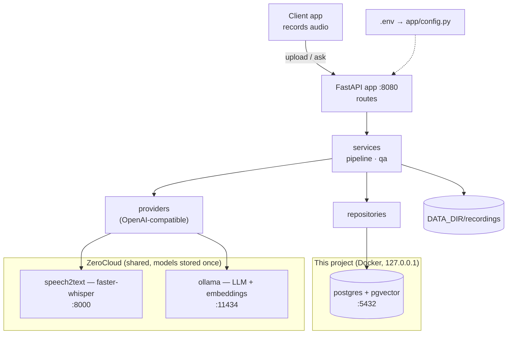
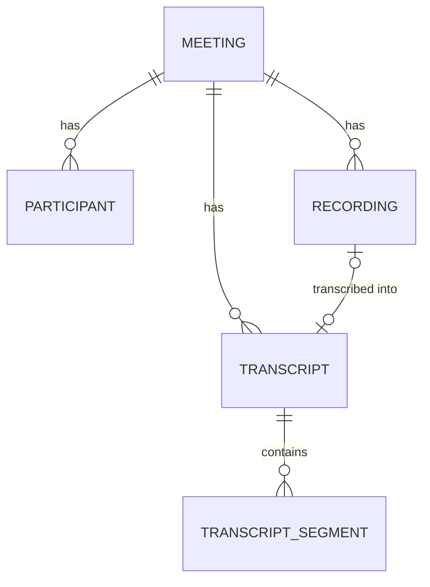
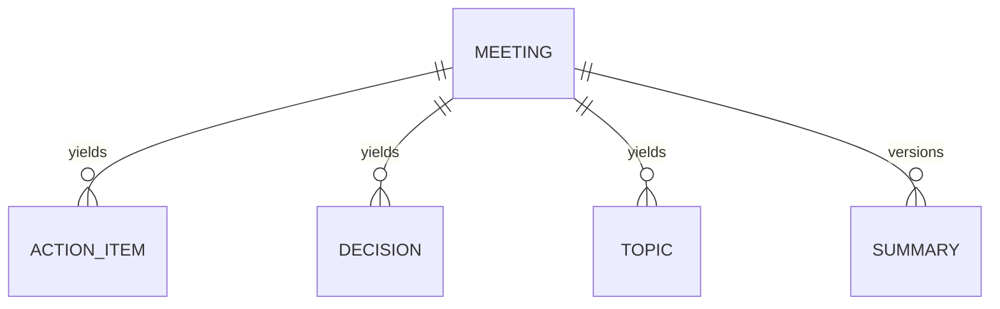
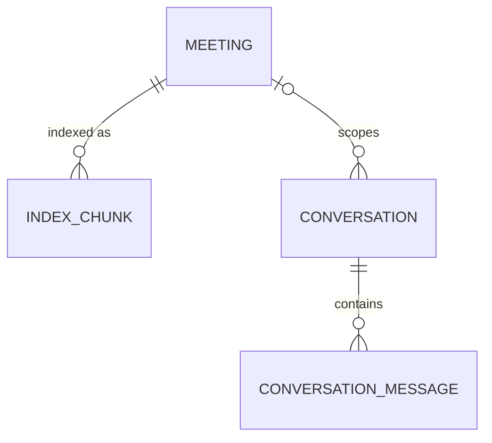

# Architecture

Detailed architecture of Syntix `iws`. The high-level diagram (client, API, services, providers and the
local Docker containers) is also shown in the **Architecture** section of the [README](../README.md); keep
the two copies in sync.

## Table of Contents

1. [Overview](#overview)
2. [Requirements](#requirements)
3. [Presentation Layer](#presentation-layer)
4. [Business Logic Layer](#business-logic-layer)
5. [Data Layer](#data-layer)
6. [Security](#security)
7. [Scalability](#scalability)
8. [Reference](#reference)

## Overview

The AI containers are not part of this project: they run in the shared [ZeroCloud](../../../../ZeroCloud/README.md) stack, which keeps every model once on disk for all projects. The API reaches them over the host ports (`localhost:11434`, `localhost:8000`) or, when the API itself runs in a container, over ZeroCloud's `zerocloud` Docker network.

### Components

| ID | Component | Layer | File |
| -- | --------- | ----- | ---- |
| C1 | FastAPI app and startup | Presentation | `app/main.py` |
| C2 | Settings, DB target (`database_target()`) | Configuration | `app/config.py` |
| C3 | Engine, `session_scope`, `init_database` (extension + HNSW index) | Data | `app/db/session.py` |
| C4 | Domain models | Data | `app/models/` |
| C5 | Repositories incl. vector search | Data | `app/repositories/` |
| C6 | STT / chat / embedding providers | Business logic | `app/providers/` |
| C7 | Pipeline and services | Business logic | `app/services/` |
| C8 | Routers (incl. `/health`, `/`) and schemas | Presentation | `app/routes/`, `app/schemas/` |

## Requirements

**Functional**

- Capture a meeting by uploading a recording or importing a transcript
- Transcribe, enrich (action items, decisions, topics), summarise and index each meeting
- Answer questions about one meeting or all meetings, with cited sources
- Keep a history of questions and answers (conversations)

**Non-functional**

- **Local-first** — no data leaves the host; every dependency runs on the local machine (the AI models in ZeroCloud, so they are stored once rather than per project)
- **Provider-agnostic** — speech-to-text, chat and embeddings are interchangeable OpenAI-compatible endpoints
- **Idempotent** — re-running the pipeline is safe
- **Testable without infrastructure** — SQLite and fake providers replace Postgres and the AI services

**Known constraints** are listed in the [changelog](CHANGELOG.md#known-limitations).

## Presentation Layer

FastAPI routers in `app/routes/` (`defaults.py`, `meetings.py`, `processing.py`, `qa.py`) validate requests with the Pydantic
schemas in `app/schemas/` and delegate to services built by `app/services/factory.py`. Routes hold no business
logic. The endpoint list is in the [README](../README.md).

- **Errors** — services raise `AppError` subclasses (`app/exceptions/`); the registered handlers turn them into JSON responses
- **Recording happens in the client** — a container cannot reach a microphone, so a browser or desktop client captures audio and uploads it
- **Long-running work** — `POST …/process` returns `202` immediately; clients poll `GET /meetings/{id}` for the status

## Business Logic Layer

Services in `app/services/` implement the use cases; `app/providers/` hides the AI integrations behind interfaces
so services never call an HTTP API directly.

### Data flow

1. **Capture** — the client uploads audio (`POST …/recordings`) or imports a transcript. Files are streamed to `DATA_DIR/recordings/<meeting_id>/` with a SHA-256 and size limit.
2. **Process** — `POST …/process` validates the meeting, marks it `QUEUED` and starts a background task that runs the stages below, updating `Meeting.status` at each step. Any failure sets `FAILED` and stores the message.
3. **Transcribe** — each recording without a transcript goes to the STT endpoint; segments are stored with timestamps.
4. **Enrich** — the LLM returns JSON (action items, decisions, topics) per transcript window; results are de-duplicated and replace the previous set.
5. **Summarise** — a Markdown summary (partial summaries merged for long meetings) is stored as the next version.
6. **Index** — transcript segments and summary paragraphs are chunked (`CHUNK_TARGET_CHARS`, `CHUNK_OVERLAP_CHARS`), embedded and swapped into `index_chunks` in one transaction.
7. **Ask** — `POST /ask` embeds the question, runs a cosine search (optionally limited to one meeting, never including soft-deleted meetings), prompts the LLM with the numbered excerpts and returns the answer plus its sources. If nothing relevant is found the LLM is not called.

### Meeting status

`CREATED → RECORDED → QUEUED → TRANSCRIBING → ENRICHING → SUMMARIZING → INDEXING → READY`, or `FAILED` with
`error_message`. Meetings left mid-run by an API restart are marked `FAILED` on startup and can be re-processed.

### Providers

| Interface (`providers/base.py`) | Implementations | Selected by |
| ------------------------------- | --------------- | ----------- |
| Transcription, Chat, Embedding | `openai_compatible.py` (Ollama, faster-whisper, hosted APIs), `fake.py` (tests) | `AI_PROVIDER` in `providers/factory.py` |

To add a provider type: define the interface in `providers/base.py`, implement it, and add a branch in `providers/factory.py`.

## Data Layer

PostgreSQL with pgvector holds both the relational data and the vectors. `app/db/session.py` builds the engine
(Postgres, or SQLite for tests), provides `session_scope`, and `init_database()` creates the tables, the `vector`
extension and the HNSW index. Recording bytes live on disk under `DATA_DIR/recordings`; the database row keeps the
path, size and SHA-256.

### Data model

All tables extend `BaseModel` (UUID `id`, `created_at`, `updated_at`, `delete_at`) and hang off `meetings`.

Shown in three narrow parts (`MEETING` is the root of each) so the diagrams read top-down.

**1. Capture and transcripts** — `meetings`, `transcripts`

**2. Insights** — `enrichment`, `summaries`

**3. Search and Q&A** — `indexing`, `qa`

| Group (`app/models/…`) | Tables | Notes |
| ---------------------- | ------ | ----- |
| `meetings` | `meetings`, `meeting_participants`, `recordings` | Recording bytes live on disk; the row keeps path, size, SHA-256 |
| `transcripts` | `transcripts`, `transcript_segments` | `source` is `STT` or `IMPORTED`; segments keep `seq`, speaker, `start_ms`/`end_ms` |
| `enrichment` | `action_items`, `decisions`, `topics` | Replaced on every pipeline run |
| `summaries` | `summaries` | Versioned; a re-run adds `version + 1` |
| `indexing` | `index_chunks` | `vector(EMBEDDING_DIMENSIONS)` + HNSW cosine index; `source` is `TRANSCRIPT` or `SUMMARY` |
| `qa` | `conversations`, `conversation_messages` | Assistant messages store the `sources` they cited |

### Changing the contract

To add a table: put the model in the matching `app/models/<group>/` package (or a new group), export it from that
group's `__init__.py` and `app/models/__init__.py` so `init_database()` registers it, then add a repository
subclassing `MeetingScopedRepository` / `BulkRepository` and inject it through `app/services/factory.py`.

There are no migrations: tables come from `create_all`. Changing `EMBEDDING_DIMENSIONS` (or the embedding model)
needs `index_chunks` dropped and the meetings re-processed.

## Security

- The API has no authentication yet; containers publish their ports on `127.0.0.1` only
- Recordings and transcripts are sensitive and stored under `DATA_DIR`, outside the repository
- Soft-deleted meetings (`delete_at` set) are excluded from lists and search

Operational guidance (secrets, `DEBUG`, `CORS_ORIGINS`, where to put `DATA_DIR`) is in the README's **Security** section.

## Scalability

Current design: a single API process that runs the pipeline as FastAPI background tasks.

- There is no job queue or multi-worker coordination; a restart mid-run marks the meeting `FAILED` and it is re-processed manually
- Recordings are stored on the local disk, so running several API instances needs shared storage
- The AI services are reached over HTTP, so ZeroCloud's Ollama and STT server can move to other hosts or hosted services through `.env`
- Vector search uses a pgvector HNSW cosine index

## Reference

- <https://martinfowler.com/architecture/>
- [pgvector](https://github.com/pgvector/pgvector)
